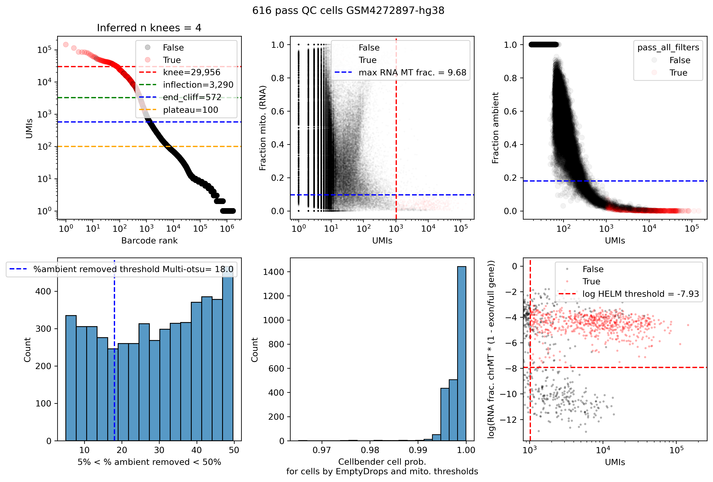

# Example: single-cell RNA-seq (scRNA)

QC of 10x 3' gene-expression libraries prepared from whole cells. It is the same
as [snRNA](../single_nuclei_RNASeq/README.md) except for one filter. Whole
cells naturally have mostly exonic reads, so the snRNA exon-ratio filter is
replaced by the **HELM** filter.

## Input

Run `cellranger count` and point `location` at its `outs/` directory. The
pipeline reads:

| File | Used for |
|---|---|
| `raw_feature_bc_matrix.h5` | RNA counts (CellBender, emptyDrops, UMI metrics) |
| `possorted_genome_bam.bam` | Intron/exon counting, mitochondrial fraction |

RNA-only samples don't use the `tss`/`chrom_sizes` references, but the samplesheet
still needs a `genome` column.

## Run

```bash
nextflow run /path/to/Multiome_JointQC_Nextflow/main.nf \
  --samplesheet examples/single_cell_RNASeq/samplesheet.txt -profile slurm

# Great Lakes
sbatch /path/to/Multiome_JointQC_Nextflow/conf/greatlakes/launch.sh samplesheet.txt
```

## Main outputs

The output directories are the same as for [snRNA](../single_nuclei_RNASeq/README.md#main-outputs).
The QC results are in `rna_qc/`. `<sample>.outmetrics.csv` has three extra columns:
`rna_helm_metric`, `rna_log_helm_metric` and `filter_helm`. It has no
`filter_rna_exon_to_full_gene_body_ratio` column.

To get the pass-QC barcodes, keep the rows of `rna_qc/<sample>.outmetrics.csv`
where `pass_all_filters` is `True`.

## QC plot: `rna_qc/<sample>.qcPlot.png`



A 2×3 grid. The title gives the number of pass-QC cells.

| Panel | Shows | Threshold |
|---|---|---|
| Top left | **Barcode-rank (knee) plot**: RNA UMIs per barcode, ranked | Knee, inflection, end-of-cliff and plateau lines from emptyDrops. The title shows the number of knees found. |
| Top middle | **RNA mitochondrial fraction vs. UMIs** | Blue: max mito fraction. Red: min UMIs. |
| Top right | **CellBender fraction of counts removed vs. UMIs** | Blue: max fraction removed |
| Bottom left | **Histogram of % ambient removed** (barcodes between 5% and 50%) | Blue: multi-Otsu cutoff |
| Bottom middle | **CellBender cell probability** for barcodes that pass emptyDrops and the mito filter | Barcodes need probability ≥ 0.99 |
| Bottom right | **log(HELM) vs. UMIs** | Red: min log HELM |

### About HELM

`HELM = rna_fraction_mitochondrial × (1 − rna_exon_to_full_gene_body_ratio)`

An intact cell has some mitochondrial reads and some intronic (unspliced)
reads. Barcodes with *almost no* mitochondrial reads *and* almost no
intronic reads, giving a very low HELM, are usually cell fragments, not whole cells. The filter keeps barcodes with log HELM at or above a
threshold set from the data's distribution.

## Upset plot: `rna_qc/<sample>.upsetPlot.png`

Counts how many barcodes pass each combination of filters. The bar with every
dot filled is the pass-QC set.

| Filter column | A barcode passes when… |
|---|---|
| `filter_rna_emptyDrops` | emptyDrops (at `--emptydrops_fdr`) distinguishes it from background |
| `filter_rna_min_umi` | It has enough RNA UMIs |
| `filter_pct_cellbender_removed` | Ambient RNA removed by CellBender is below the cutoff |
| `filter_cellbender_cell_probability` | CellBender cell probability ≥ 0.99 |
| `filter_rna_max_mito` | RNA mitochondrial fraction is low |
| `filter_helm` | log HELM is above the cutoff (not a low-mito, low-intron fragment) |
