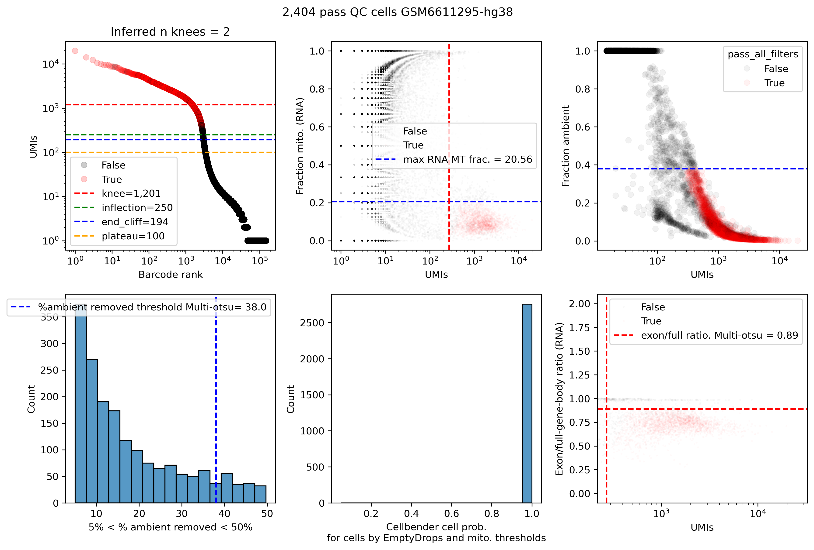

# Example: single-nucleus RNA-seq (snRNA)

QC of 10x 3' gene-expression libraries prepared from nuclei. A nucleus passes
when its RNA profile looks like an intact, uncontaminated nucleus.

## Input

Run `cellranger count` (with intronic reads included, the default since
Cell Ranger 7) and point `location` at its `outs/` directory. The pipeline
reads:

| File | Used for |
|---|---|
| `raw_feature_bc_matrix.h5` | RNA counts (CellBender, emptyDrops, UMI metrics) |
| `possorted_genome_bam.bam` | Intron/exon counting, mitochondrial fraction |

RNA-only samples don't use the `tss`/`chrom_sizes` references, but the samplesheet
still needs a `genome` column.

## Run

```bash
nextflow run /path/to/Multiome_JointQC_Nextflow/main.nf \
  --samplesheet examples/single_nuclei_RNASeq/samplesheet.txt -profile slurm

# Great Lakes
sbatch /path/to/Multiome_JointQC_Nextflow/conf/greatlakes/launch.sh samplesheet.txt
```

## Main outputs

| Directory | Contents |
|---|---|
| `rna_qc/` | `<sample>.qcPlot.png`, `<sample>.upsetPlot.png`, `<sample>.outmetrics.csv` (per-barcode metrics and filter results), `<sample>.log` |
| `cellbender/` | Ambient-RNA-corrected counts `<sample>.cellbender_FPR_<fpr>.h5`. **Use these for downstream analysis.** |
| `qc_report.html` | Summary report covering all samples |
| `qc/` | Per-barcode RNA read/UMI metrics |
| `splitter/`, `counter/`, `emptyDrops/` | Intermediate files |

To get the pass-QC barcodes, keep the rows of `rna_qc/<sample>.outmetrics.csv`
where `pass_all_filters` is `True`.

## QC plot: `rna_qc/<sample>.qcPlot.png`



A 2×3 grid; it's the RNA part of the multiome plot. The title gives the number
of pass-QC nuclei.

| Panel | Shows | Threshold |
|---|---|---|
| Top left | **Barcode-rank (knee) plot**: RNA UMIs per barcode, ranked | Knee, inflection, end-of-cliff and plateau lines from emptyDrops. The title shows the number of knees found. |
| Top middle | **RNA mitochondrial fraction vs. UMIs** | Blue: max mito fraction. Red: min UMIs. |
| Top right | **CellBender fraction of counts removed vs. UMIs** | Blue: max fraction removed |
| Bottom left | **Histogram of % ambient removed** (barcodes between 5% and 50%) | Blue: multi-Otsu cutoff |
| Bottom middle | **CellBender cell probability** for barcodes that pass emptyDrops and the mito filter | Barcodes need probability ≥ 0.99 |
| Bottom right | **Exon / full-gene-body ratio vs. UMIs** | Red: max ratio. Nuclear RNA is intron-rich, so barcodes with mostly exonic reads are likely ambient or cytoplasmic contamination. |

## Upset plot: `rna_qc/<sample>.upsetPlot.png`

Counts how many barcodes pass each combination of filters. The bar with every
dot filled is the pass-QC set.

| Filter column | A barcode passes when… |
|---|---|
| `filter_rna_emptyDrops` | emptyDrops (at `--emptydrops_fdr`) distinguishes it from background |
| `filter_rna_min_umi` | It has enough RNA UMIs |
| `filter_pct_cellbender_removed` | Ambient RNA removed by CellBender is below the cutoff |
| `filter_cellbender_cell_probability` | CellBender cell probability ≥ 0.99 |
| `filter_rna_max_mito` | RNA mitochondrial fraction is low |
| `filter_rna_exon_to_full_gene_body_ratio` | Exon/full-gene-body ratio is below the cutoff |
