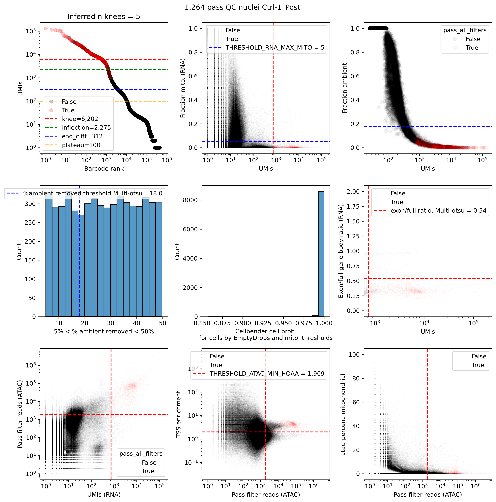

# Example: single-nucleus Multiome (RNA + ATAC)

Joint QC of 10x Multiome libraries. A nucleus passes only if both its RNA
and its ATAC signal pass QC.

## Input

Run `cellranger-arc count` and point `location` at its `outs/` directory. The
pipeline reads:

| File | Used for |
|---|---|
| `raw_feature_bc_matrix.h5` | RNA counts (CellBender, emptyDrops, UMI metrics) |
| `gex_possorted_bam.bam` | Intron/exon counting, RNA mitochondrial fraction |
| `atac_possorted_bam.bam` | ataqv per-nucleus ATAC metrics |
| `atac_fragments.tsv.gz` | ATAC bigwig |

The `genome` column needs `tss` and `chrom_sizes` entries in your config (see
[conf/references.example.config](../../conf/references.example.config)).

## Run

```bash
nextflow run /path/to/Multiome_JointQC_Nextflow/main.nf \
  --samplesheet examples/single_nuclei_multiome/samplesheet.txt \
  -c my_references.config -profile slurm

# Great Lakes
sbatch /path/to/Multiome_JointQC_Nextflow/conf/greatlakes/launch.sh samplesheet.txt
```

## Main outputs

| Directory | Contents |
|---|---|
| `joint_qc/` | `<sample>_qcPlot.png`, `<sample>_upsetPlot.png`, `<sample>_metrics.txt` (per-barcode metrics and filter results) |
| `cellbender/` | Ambient-RNA-corrected counts `<sample>.cellbender_FPR_<fpr>.h5`. **Use these for downstream analysis.** |
| `qc_report.html` | Summary report covering all samples |
| `qc/`, `interactive-barcode-rank-plots/` | RNA read/UMI QC and interactive barcode-rank plots |
| `atac_qc/`, `ataqv/single-nucleus/` | ataqv metrics: bulk HTML viewer, per-nucleus tables and plots |
| `bigwig/` | ATAC coverage bigwigs, plus signal plots at TSSs of `params.plot_signal_at_genes` |
| `splitter/`, `counter/`, `emptyDrops/` | Intermediate files |

To get the pass-QC barcodes, keep the rows of `joint_qc/<sample>_metrics.txt`
where `pass_all_filters` is `True`. The RNA and ATAC modalities both use
the RNA (GEX) barcode.

## QC plot: `joint_qc/<sample>_qcPlot.png`



A 3×3 grid. In the scatter plots each point is one barcode, and dashed lines
show the thresholds the pipeline picked for this sample. The title gives the
number of nuclei that pass every filter.

| Panel | Shows | Threshold |
|---|---|---|
| Row 1, left | **Barcode-rank (knee) plot**: RNA UMIs per barcode, ranked | Knee, inflection, end-of-cliff and plateau lines from emptyDrops. The title shows the number of knees found; more than one can mean a mix of cell populations or debris. |
| Row 1, middle | **RNA mitochondrial fraction vs. UMIs** | Blue: max mito fraction, chosen from the distribution's peaks. Red: min UMIs. |
| Row 1, right | **CellBender fraction of counts removed vs. UMIs**: how much of each barcode's RNA CellBender called ambient | Blue: max fraction removed |
| Row 2, left | **Histogram of % ambient removed** (barcodes between 5% and 50%) | Blue: multi-Otsu cutoff used for `filter_pct_cellbender_removed` |
| Row 2, middle | **CellBender cell probability** for barcodes that pass emptyDrops and the mito filter | Barcodes need probability ≥ 0.99 |
| Row 2, right | **Exon / full-gene-body ratio vs. UMIs** | Red: max ratio. Nuclear RNA has plenty of intronic reads, so a high exon fraction points to cytoplasmic or ambient contamination. |
| Row 3, left | **ATAC high-quality autosomal reads (HQAA) vs. RNA UMIs**: agreement between the two modalities | Red: min HQAA and min UMIs |
| Row 3, middle | **ATAC TSS enrichment vs. HQAA** | Min HQAA (multi-Otsu on log HQAA); min TSS enrichment = 2 |
| Row 3, right | **ATAC mitochondrial % vs. HQAA** | Green: max ATAC %chrMT. Drawn and applied only when `--filter_MT_ATAC true`. |

## Upset plot: `joint_qc/<sample>_upsetPlot.png`

Counts how many barcodes pass each combination of filters. Each bar is one
combination, and the dots below show which filters passed. The bar with every
dot filled is the pass-QC set. Large bars missing a single filter show which
filter is removing the most barcodes.

| Filter column | A barcode passes when… |
|---|---|
| `filter_rna_emptyDrops` | emptyDrops (at `--emptydrops_fdr`) distinguishes it from background |
| `filter_rna_min_umi` | It has enough RNA UMIs |
| `filter_pct_cellbender_removed` | Ambient RNA removed by CellBender is below the cutoff |
| `filter_cellbender_cell_probability` | CellBender cell probability ≥ 0.99 |
| `filter_rna_max_mito` | RNA mitochondrial fraction is low |
| `filter_rna_exon_to_full_gene_body_ratio` | Exon/full-gene-body ratio is below the cutoff (nuclear-like RNA) |
| `filter_atac_min_hqaa` | It has enough high-quality ATAC reads |
| `filter_atac_min_tss_enrichment` | ATAC TSS enrichment ≥ 2 |
| `filter_atac_max_mito` | ATAC mitochondrial % is low (only with `--filter_MT_ATAC true`) |
